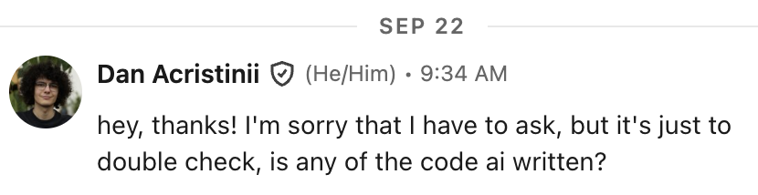
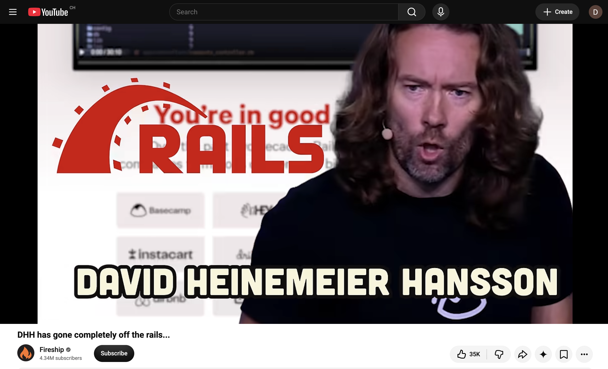
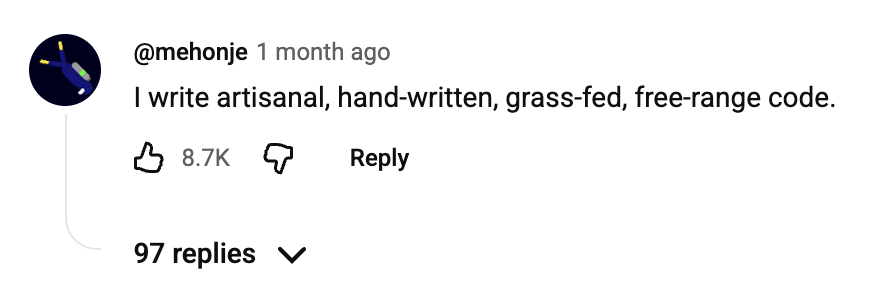
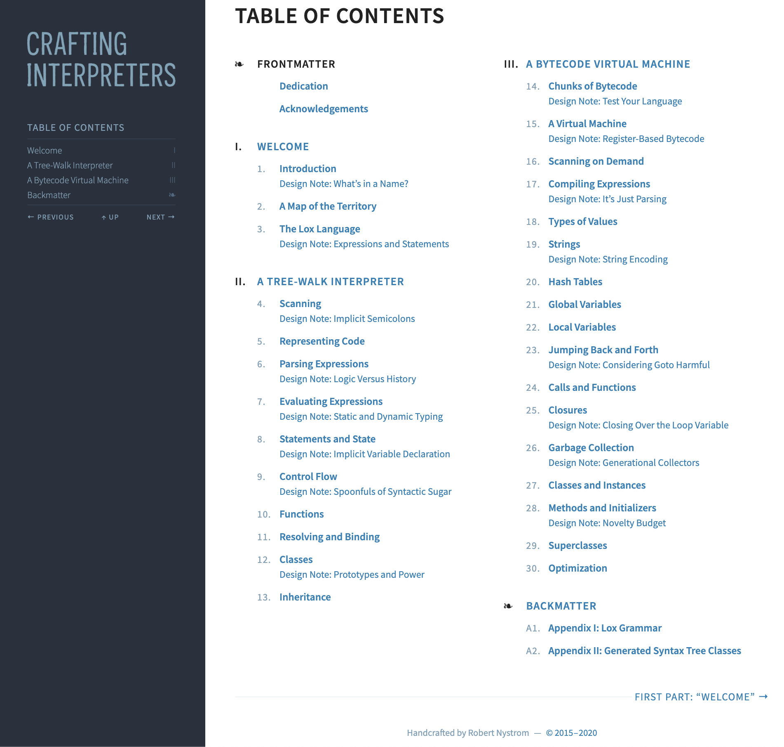
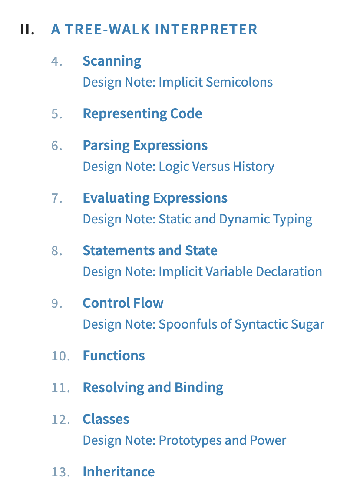

# Crafting Interpreters.

Writing a <span v-mark.highlight.green>**tokenizer**</span>, a <span v-mark.highlight.orange>**recursive-descent parser**</span> and an <span v-mark.highlight.blue>**interpreter**</span> in Go  
by following Robert Nystrom's book "Crafting Interpreters".

[github.com/davidkuda/crafting-interpreters](https://github.com/davidkuda/crafting-interpreters)

---
layout: two-cols-header
---

# What's in this talk?

::left::

### goals

- Show you how my year with the book was.
- structure is planned, content is improvised.
- what to expect from the book.
- time will not suffice to cover everything.

::right::

<div v-click.up>

### non-goals

- a sophisticated analysis of programming languages and interpreter and compiler techniques.

</div>

---

# `whoami`

```yaml [about.yaml] {all|2|3|4|5|6|7-11|7,12-|all}
about:
  name: David Kuda
  description: husband, father of 2, soon 3.
  job: Software Engineer @Noser Engineering AG
  education: KV w/ Berufsmatura, Business Bachelor @HWZ, self-taught SWE
  experience: 6 years as SWE, before that 13 years as business person
  interests:
  - programming, golang, computer science
  - linux, terminals, vim
  - split keyboards
  - HTMX, vanilla JavaScript
  - CrossFit
  - Reading
  - Making Music, guitar, singing
  - Tibetan Buddhism
```


---
layout: center
transition: slide-up
---

# Is this written by AI?

<div v-click.up>
  
</div>


---
transition: slide-up
layout: statement
---

# To answer you this...

### <div v-click.up>Who of you has seen the following video?</div>

---
transition: slide-up
---

<div class="flex items-center justify-center h-full w-full p-8">
  
</div>


---
transition: slide-up
layout: statement
---

## Well, I wanted to mislead you a little. It's not about the video, but its <span v-mark.highlight.orange>top comment</span>.

<div v-click.up>

</div>

---
transition: slide-up
layout: statement
---

<h2>Most of the code was hand-written by me<br>
on this Macbook in neovim. ✍️🧑‍💻🙂</h2>

<p>
  <span v-click>(I use neovim, btw. 😄)</span>
  <span v-click> (but for presentations I use VSCode 😄)</span>
</p>

<h3 v-click>(I did chat a few times with ChatGPT, though,<br>
but I tried not doing it too often. 🙃)</h3>

---
layout: image-right
image: ./img/craftint-cover.avif
backgroundSize: auto 85%
---

# About the Book "Crafting Interpreters"

- Part 1: Welcome
- <span v-mark.highlight.orange>Part 2: A Tree-Walking Interpreter</span>
  - <span v-mark.strike.orange>`jlox`</span>    <span v-click.up>`golox`</span>
  - Written in Java
- Part 3: A ByteCode Virtual Machine
  - `clox`
  - Written in C
---



---



---
layout: section
---

# The Mental Model

---
layout: center
---

# The Mental Model:

```
[ scanner ] -> [ parser ] -> [ interpreter ]
```
---
layout: center
---

# The Mental Model:


| **Stage** | **Input** | **Output** |
|---|---|---|
| Scanner | Source code | `[]Token` |
| Parser | `[]Token` | AST (`Expr`, `Stmt`) -> `[]Stmt` |
| Interpreter | AST / `[]Stmt` | Runtime values / side effects |

---
layout: two-cols-header
layoutClass: gap-8
---

# The Mental Model:

::left::

```go {all|1-3|5-7|9-11|all}
func (g *Golox) ScanSourceCode(code []byte) ([]Token, error) {
    ...
}

func (g *Golox) ParseTokens(tokens []Token) ([]Stmt, error) {
    ...
}

func (g *Golox) InterpretAST(stmts []Stmt) error {
    ...
}
```

::right::


````md magic-move {lines: true}
```go
func main() {}
```

```go
func main() {
    src := []byte("var a = 42;")
}
```

```go
func main() {
    src := []byte("var a = 42;")

    tokens, _ := g.ScanSourceCode(src)
}
```

```go
func main() {
    src := []byte("var a = 42;")

    tokens, _ := g.ScanSourceCode(src)

    stmts, _ := g.ParseTokens(tokens)
}
```

```go
func main() {
    src := []byte("var a = 42;")

    tokens, _ := g.ScanSourceCode(src)

    stmts, _ := g.ParseTokens(tokens)

    g.Interpret(stmts)
}
```
````

---
layout: section
---

# The Lox Programming Language

---
layout: two-cols-header
layoutClass: gap-1
---

# The Lox Programming Language


::left::

```
fun greet(name) {
  print "hello " + name + " !";
}

var name = "Go Meetup Zurich";

greet(name);
```

<div v-click.up>

```
fun fib(n) {
  if (n <= 1) return n;
  return fib(n - 2) + fib(n - 1);
}

for (var i = 0; i < 21; i = i + 1) {
  print fib(i);
}

```
</div>

::right::

<div v-click.up>

```
fun count(n) {
    var value = n;

    if (n > 0) {
        count(n - 1);
    }

    print value;
}

count(5);
```
</div>

---

# Lox Grammar Rules

[Attachment 2: Lox Grammar](https://craftinginterpreters.com/)

---
layout: section
---

# Dealing With Errors

---
layout: two-cols-header
layoutClass: gap-8
---

# Dealing With Errors

::left::

### Scanner Errors

Scanner does not allow all characters,  
e.g., single quotes:

```
var s = "this is ok";
```

```
var t = 'this is not ok, scan error';
```

::right::

<div v-click>

### Parser Errors

Grammar, syntax; follow you must.  
e.g., paranthesis after if:

```
if (true) print "ok";
```

```
if true print "not ok";
```

</div>

---
layout: two-cols-header
layoutClass: gap-8
---

# Dealing With Errors

::left::

### Interpreter Errors

Passes scanner, passes parser, but fails to interpret.

```
42 + "answer"
```

---

# Wrap Up

What was hard?
- designing the API, structuring the code
- simple things like to use a pointer or not
- errors, NewScannerError, implement Error() string
- dealing with generic interfaces, parser Stmt and Expr nodes
- how to print and debug stuff
- dealing with nil
- some java shenanigans

---

# TODO:
- [x] Grammar
- [ ] sample lox code, whiteboard-like "what is happening right now"
- [x] show how we deal with errors, e.g. forget the hyphens in an if statement
